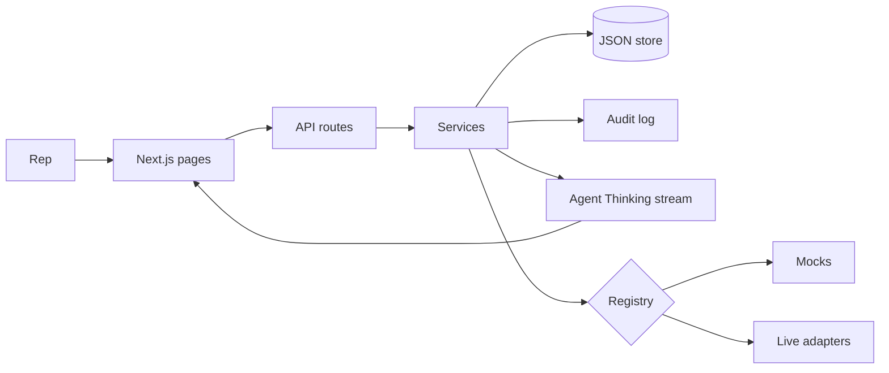

# Architecture

Routes only call services. Every outside service sits behind an interface in `src/providers`, and `registry.ts` picks mock or live from the environment.

## The loop

Ideal customer → discover → filter → score → enrich → draft → review → **rep approves** → send → reply → pipeline.

| Step | Code | Rule |
| --- | --- | --- |
| Ideal customer | `services/icp.ts` | Confidence is clamped to 0–1; a missing section saves nothing |
| Discover | `services/discovery.ts` | Records and fields that cite an unread page are dropped |
| Filter | `services/negativeSignals.ts` | Hides leads with a reason; never deletes |
| Score | `services/scoring.ts` | Below |
| Enrich | `services/enrichment.ts` | Tries vendors until an email is valid; checks mail servers |
| Draft and review | `services/outreach.ts` | Word limits; a second AI pass removes unsupported claims |
| Approve | `services/outreach.ts` | One message at a time; editing needs a new approval |
| Send | `services/send.ts` | 403 unless approved; security checks; daily limit |

## Score

Fit, up to 60: industry 20, size 15, buyer 20 (8 if less certain), region 5.
Intent, up to 40: funding 12, new leader 10, job post 10, technology change 8, renewal 12. Halved after 90 days and capped at 30, plus 5 for a warm introduction and 5 for a winnable competitor.
Tier A is 75 or more, B is 50 to 74, C is below 50.

## Graph

Held in memory and rebuilt from the store. Any other edge is rejected.

| Edge | From | To |
| --- | --- | --- |
| works_at, previously_employed_at | Person | Company |
| competes_with | Competitor | Product |
| matched_to | Company or Signal | Product or Company |
| contacted_via, replied_to | Person | Product |

Queries in `services/graphReasoning.ts`:
1. **warmIntros:** shared employers, up to 3 hops, or a shared school.
2. **activeEvaluations:** job posts from the last 60 days at matched companies.
3. **displacementTargets:** renewals or churn risks that name a competitor.

Neo4j is not built, so there are no Cypher queries.

## Agents

Planner, Builder, Reviewer and Security act only when @mentioned, and hand off with @mentions. A run stops at 20 messages. Sending email and changing the graph design each wait for an Approve or Deny card. Even then, only messages the rep approved one by one are sent. Agents use code for most steps; the Planner, drafting and claim review call the AI.

Approving a graph design change records it. It does not yet change the enforced schema.

## Buyer Twin

`services/twin.ts` asks the AI how a buyer in that role might react to a draft, the question they would ask, and one sentence to change. It is labeled as a simulation. Code drops a suggestion that isn't an exact sentence, removes the opening fact, adds a number, link or address, or breaks a length limit. Using one is a normal edit, so the rep must still approve. The private Ripple note is not used.

## Ripple

`services/ripple.ts` stores shared contacts and works out where each stands: in GTM, ready, outside the ideal customer, or do not contact. A contact matches a person by email, or by name and company domain.

- **Discover** adds matching, permitted contacts after web search. The Builder agent uses the same step.
- **Score** gives the 5-point warm introduction bonus.
- **Enrich** uses Ripple first, at no cost. The email is marked not checked.
- **Draft** uses a four-message sequence that opens with who they met and cites the Ripple record. The private note is never sent to the AI.
- **Send** refuses anyone marked do not contact.

## Credits

| Event | Credits |
| --- | --- |
| leads_enriched | 5 |
| outreach_sent | 1 |
| graph_queries_evaluated | 0.2 |

Each event goes to the local ledger and, with a key, to Flexprice. Enrichment returns 402 when credits run out. A Flexprice error never blocks the rep.

## Security

- Outgoing links must be https and not shortened or blocked. With live email they must also open.
- Messages with someone else's email or phone number are blocked.
- Page reading refuses private addresses.
- Webhooks and Band input need a shared token. Band can't approve anything.
- CSV export neutralizes formulas.
- There is no login yet.

## Known limits

- The store suits one server process.
- Agent messages and Agent Thinking live in memory.
- Competitors come from the demo data; live competitor research and scheduled signal refresh are not built.
